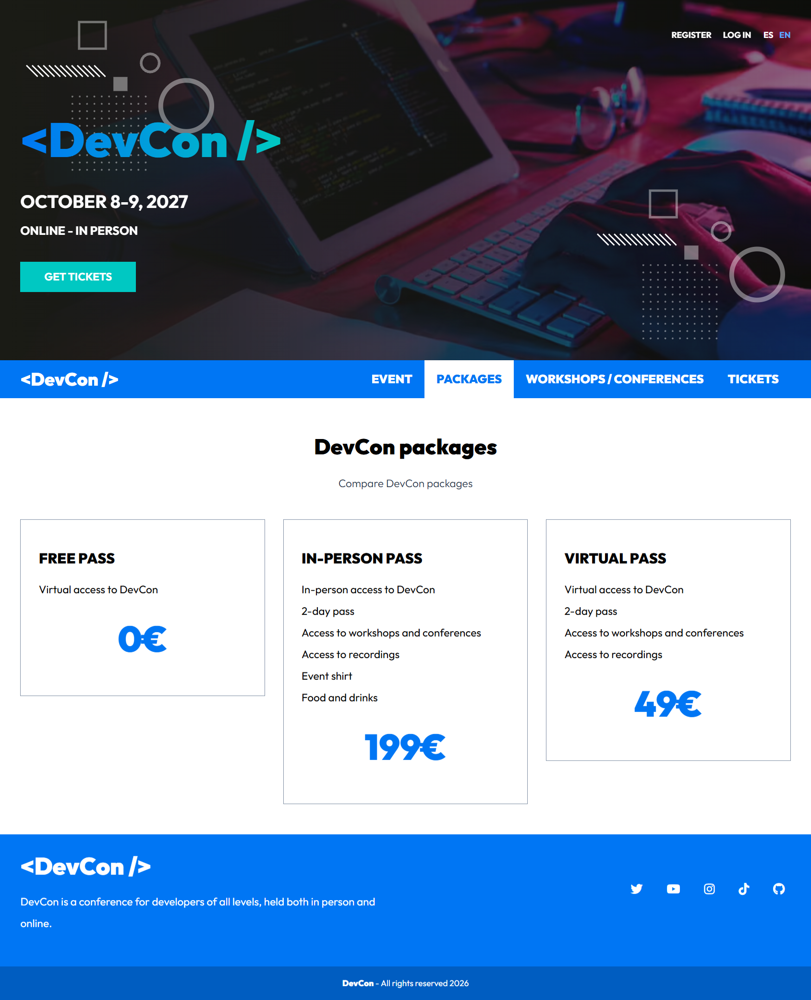
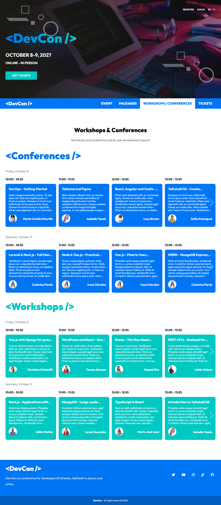
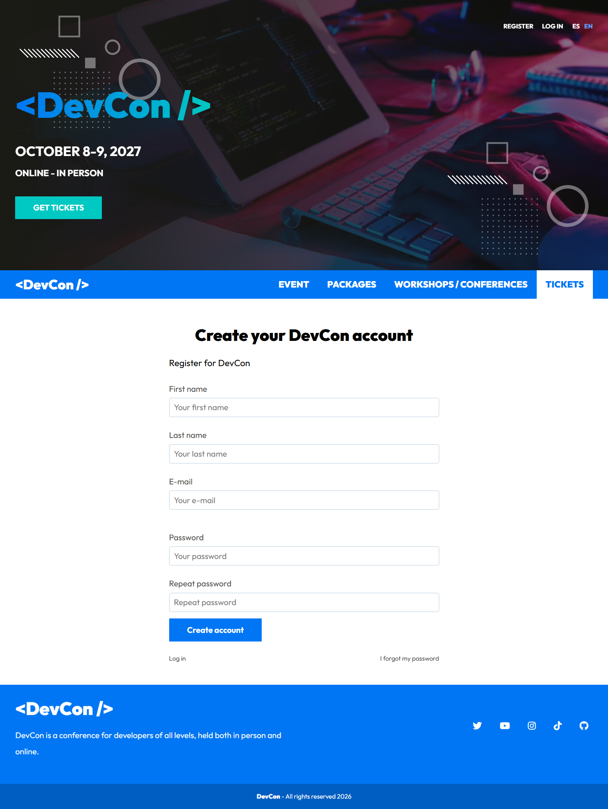
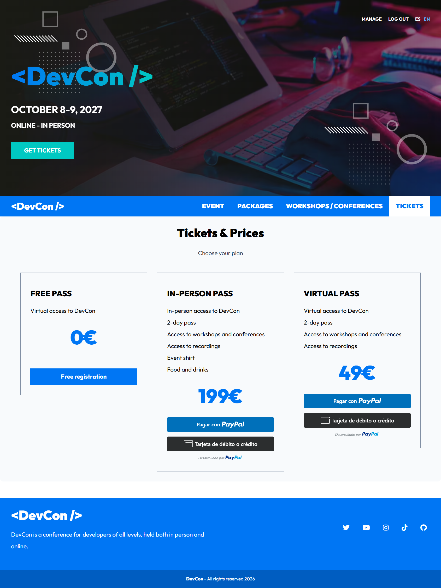
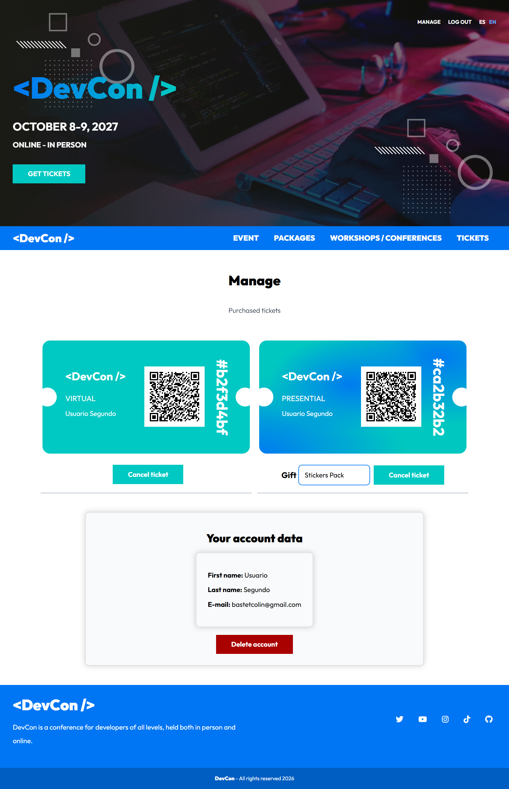
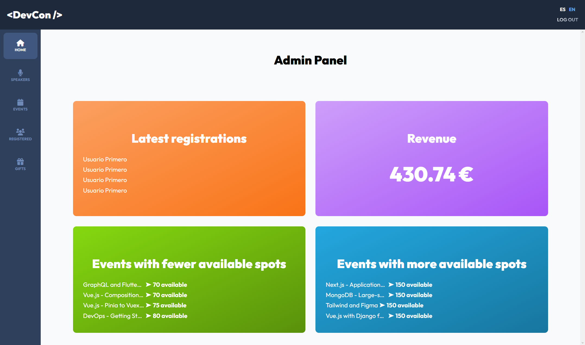
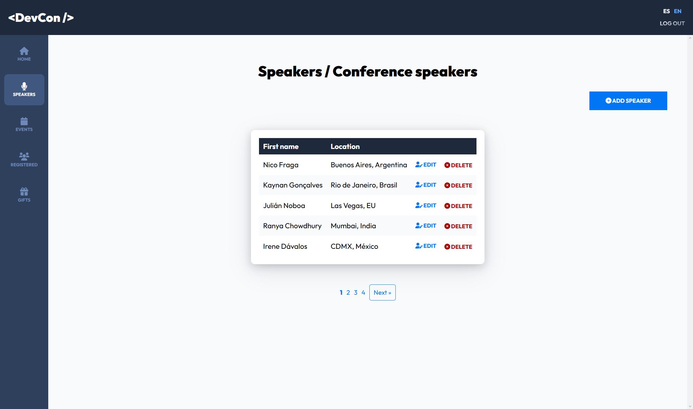
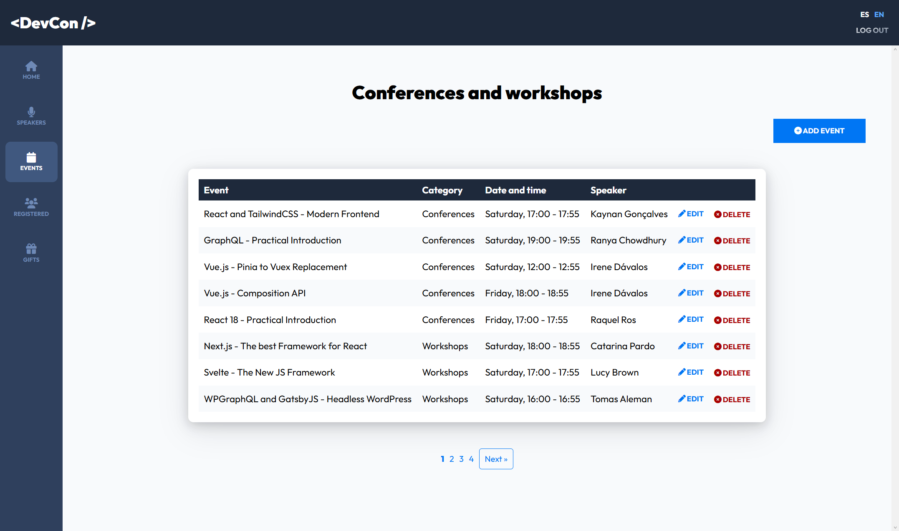
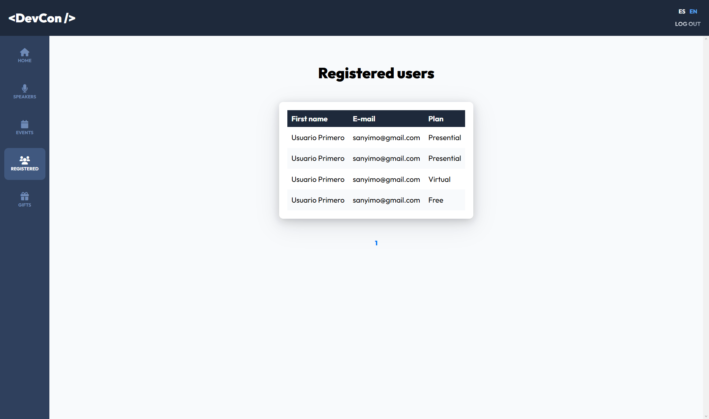
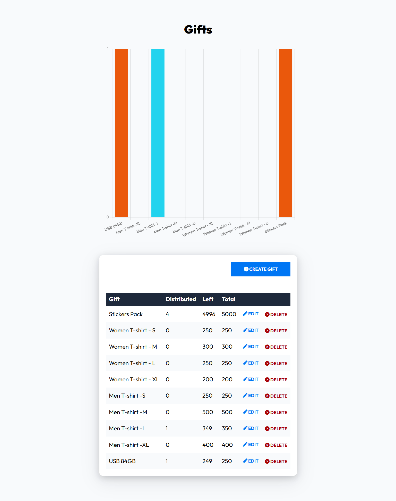

# DevCon

A web platform for a developer conference, with public event information, attendee registration and an administration panel.

Español

## Sobre el proyecto

**DevCon** es una aplicación web para gestionar una conferencia de desarrolladores. Reúne la información del evento, el programa de actividades, los ponentes, las inscripciones y la administración en una única plataforma.

El proyecto ofrece una experiencia pública para consultar la conferencia y registrarse, junto con un área privada para gestionar su contenido y las inscripciones.

## Funcionalidades

### Área pública
- Página principal con información de la conferencia.
- Consulta de ponentes y sus perfiles.
- Programa de conferencias y workshops, organizado por categorías, días y horarios.
- Información sobre los paquetes de asistencia.
- Interfaz disponible en español e inglés.

### Usuarios e inscripciones
- Registro de usuarios e inicio de sesión.
- Confirmación de cuenta por correo electrónico.
- Recuperación de contraseña.
- Inscripción a la conferencia y selección de actividades.
- Selección de regalos disponibles según las condiciones de la inscripción.
- Generación de tickets con código QR.

### Administración
- Panel con indicadores de inscripciones e ingresos estimados.
- Gestión de eventos, ponentes y regalos.
- Consulta de asistentes e inscripciones.
- Listado paginado de registros.

## Arquitectura

La aplicación sigue una arquitectura **MVC (Model-View-Controller)** desarrollada en PHP.

- **Models:** representan las entidades y gestionan el acceso a los datos mediante una capa Active Record.
- **Views:** contienen las plantillas PHP de las páginas públicas, autenticación, inscripciones y administración.
- **Controllers:** gestionan las peticiones, aplican la lógica de la aplicación y coordinan las respuestas.
- **Router:** registra y dirige las peticiones a los controladores correspondientes.
- **Includes:** contienen la inicialización, la conexión a la base de datos, las funciones comunes y las traducciones.
- **Classes:** agrupan utilidades como el envío de correos, la paginación y la generación de códigos QR.

## Tecnologías

- **Backend:** PHP 8, MySQL y `mysqli`.
- **Arquitectura:** MVC y autoload PSR-4 mediante Composer.
- **Frontend:** HTML, Sass/SCSS y JavaScript.
- **Automatización de recursos:** Gulp.
- **Librerías:** PHPMailer, Intervention Image, Endroid QR Code, Swiper y SweetAlert2.

## Internacionalización

La interfaz admite español e inglés mediante la función `t()` y el sistema de traducciones de `includes/translations.php`.

Los eventos y los regalos también disponen de campos de contenido específicos para cada idioma.

## Configuración

La aplicación utiliza variables de entorno para configurar la conexión a MySQL y los servicios que lo requieren. Las dependencias PHP se gestionan con Composer y las herramientas frontend con npm.

Para ejecutar el proyecto en un entorno local se necesita PHP, MySQL, Composer y Node.js/npm. La configuración concreta depende del entorno en el que se despliegue la aplicación.

## Capturas de pantalla

Consulta el apartado de capturas situado al final de este documento.

### Acceso de demostración

La aplicación incluye una cuenta de demostración con acceso de solo lectura al panel de administración. Permite explorar las funciones de gestión sin modificar los datos.

* **URL:** https://devcon.infinityfree.io
* **Email:** `demouser@demo.com`
* **Contraseña:** `Demo1234`

Las acciones de creación, edición y eliminación permanecen visibles, pero las peticiones que modifican datos están bloqueadas en el servidor.

English

## About the project

**DevCon** is a web application for managing a developer conference. It brings together event information, the activity schedule, speakers, attendee registration and administration in a single platform.

The project provides a public area for exploring the conference and registering, alongside a private area for managing its content and registrations.

## Features

### Public area
- Homepage with conference information.
- Speaker directory and profiles.
- Conference talks and workshops organized by category, day and time.
- Information about attendance packages.
- Spanish and English interface.

### Users and registration
- User registration and login.
- Email account confirmation.
- Password recovery.
- Conference registration and activity selection.
- Selection of available gifts according to registration conditions.
- Ticket generation with a QR code.

### Administration
- Dashboard with registration metrics and estimated revenue.
- Event, speaker and gift management.
- Attendee and registration lookup.
- Paginated registration listings.

## Architecture

The application follows the **Model-View-Controller (MVC)** architecture and is built with PHP.

- **Models:** represent entities and manage data access through an Active Record layer.
- **Views:** contain PHP templates for public pages, authentication, registration and administration.
- **Controllers:** handle requests, application logic and responses.
- **Router:** maps incoming requests to the appropriate controllers.
- **Includes:** contain application initialization, database connection, shared functions and translations.
- **Classes:** provide utilities such as email delivery, pagination and QR code generation.

## Technologies

- **Backend:** PHP 8, MySQL and `mysqli`.
- **Architecture:** MVC and PSR-4 autoloading through Composer.
- **Frontend:** HTML, Sass/SCSS and JavaScript.
- **Asset automation:** Gulp.
- **Libraries:** PHPMailer, Intervention Image, Endroid QR Code, Swiper and SweetAlert2.

## Internationalization

The interface supports Spanish and English through the `t()` function and the translation system in `includes/translations.php`.

Events and gifts also have language-specific content fields.

## Configuration

The application uses environment variables to configure the MySQL connection and any services that require them. PHP dependencies are managed with Composer, while frontend tooling is managed with npm.

Running the project locally requires PHP, MySQL, Composer and Node.js/npm. The exact configuration depends on the target environment.

## Screenshots

See the screenshots section at the end of this document.

## Demo access

The application includes a read-only demo account for exploring the administration panel without modifying data.

* **URL:** https://devcon.infinityfree.io
* **Email:** `demouser@demo.com`
* **Password:** `Demo1234`

Create, edit and delete actions remain visible, but requests that modify data are blocked server-side.

Capturas de pantalla / Screenshots

**Página principal / Homepage**

---

**Paquetes a la DevCon / DevCon packs**

---

**Eventos / Events**

---

**Crear una cuenta / Create an account**

---

**Compra de entradas / Buy tickets**

---

**Cuenta y entradas del uuario / Usar account and tickets**

---

**Panel de administración / Administration dashboard**

---

**Gestión de ponentes / Speaker management**

---

**Gestión de conferencias y workshops / Conference and workshop management**

---

**Usuarios registrados / Registered users**

---

**Panel de regalos / Gifts panel**

